

  
  
  
  
  
  

  <picture>
    <source media="(prefers-reduced-motion: reduce)" srcset="assets/tentaculo-portada-sin-movimiento.png" />
    
  </picture>

  <picture></picture> 
  <picture>
    <source media="(prefers-reduced-motion: reduce)" srcset="assets/hastur-linea-sin-movimiento.png" />
    
  </picture>

  <picture></picture>

  <picture></picture>

  <picture></picture>&nbsp;
  <picture></picture>&nbsp;
  <picture></picture>&nbsp;
  <picture></picture>&nbsp;
  <picture></picture>&nbsp;
  <picture></picture>&nbsp;
  <picture></picture>&nbsp;
  <picture></picture>

  <picture></picture>&nbsp;
  <picture></picture>&nbsp;
  <picture></picture>&nbsp;
  <picture></picture>&nbsp;
  <picture></picture>&nbsp;
  <picture></picture>&nbsp;
  <picture></picture>&nbsp;
  <picture></picture>

<h3 align="center"><picture></picture></h3>

  <picture></picture>

<!-- GOLD-GRID:START -->

<picture></picture> 
<a href="https://github.com/Workraken/WorKraken" title="WorKraken">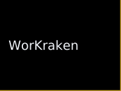</a><a href="https://workraken.com" title="Parking, payments and expense management. Property and fleet modules in preparation.">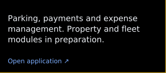</a><picture>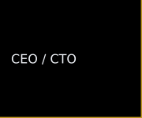</picture><picture>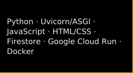</picture> 
<a href="https://github.com/Rey-de-Amarillo/Carcosa" title="Carcosa">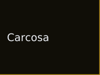</a><a href="https://github.com/Rey-de-Amarillo/Carcosa" title="Kraken Edge: a lab for sports odds, payouts and formulas.">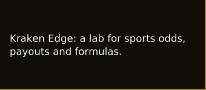</a><picture></picture><picture>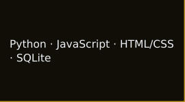</picture> 
<a href="https://github.com/Rey-de-Amarillo/ROBOILAI" title="ROBOILAI">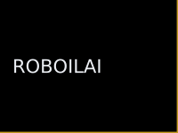</a><a href="https://roboilai.web.app/" title="Six robot designs with part-level CAD, electronics, firmware and narrated 3D demos.">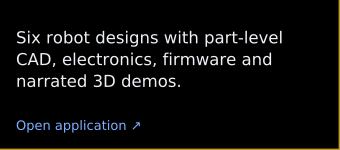</a><picture>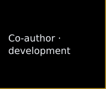</picture><picture>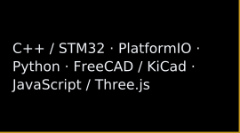</picture> 
<a href="https://github.com/Rey-de-Amarillo/grabador-de-pantalla-para-linux" title="Grabador de pantalla de Linux">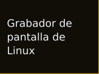</a><a href="https://github.com/Rey-de-Amarillo/grabador-de-pantalla-para-linux" title="Screen, system audio and microphone recording on Linux.">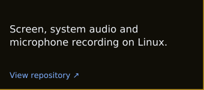</a><picture>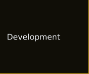</picture><picture>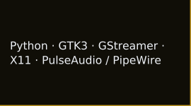</picture> 
<a href="https://github.com/Rey-de-Amarillo/Marketing" title="WorKraken Marketing">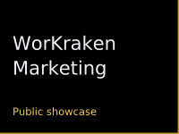</a><a href="https://workraken-marketing-1060781860075.southamerica-west1.run.app/" title="Social media content planning and publication review.">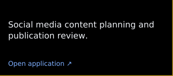</a><picture>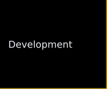</picture><picture>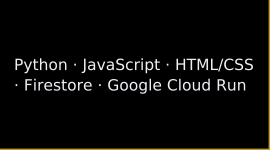</picture>

<!-- GOLD-GRID:END -->

<!-- WEBSITE:START -->
<h3 align="center"><picture></picture></h3>

  <picture></picture>

  

<!-- WEBSITE:END -->

<h3 align="center"><picture></picture></h3>

  <picture></picture>

  &nbsp;&nbsp;
  

  <picture></picture>

